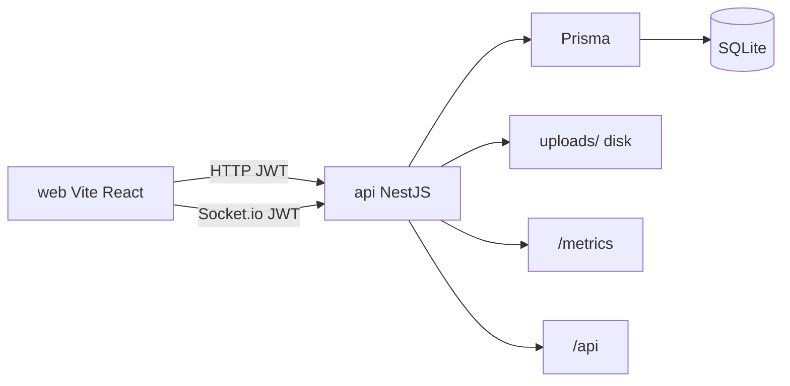
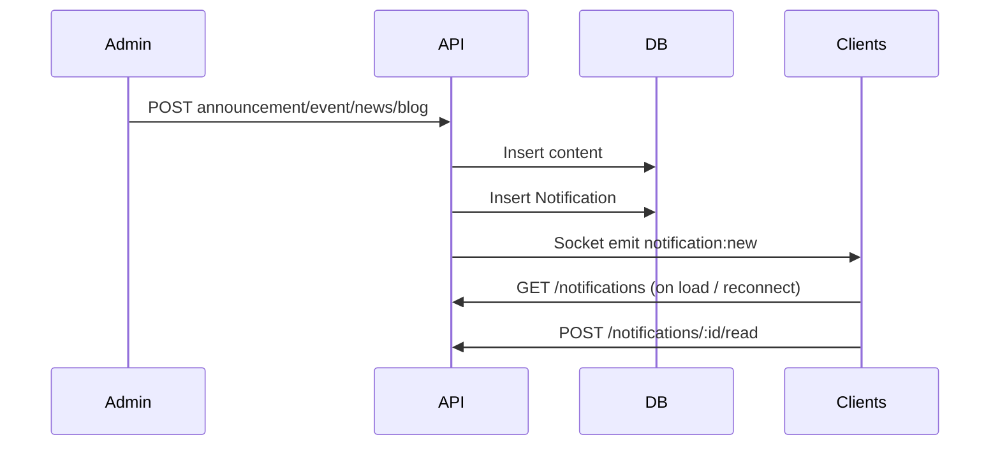

# Architecture

Team Orbit targets ~100 members. At that scale a **single NestJS deployable** with domain modules is simpler and cheaper than a microservice fleet, while still keeping clear boundaries for a later split if needed.

## High-level view



| Package | Role |
|---------|------|
| `api/` | Auth, CRUD domains, uploads, notifications, health, metrics |
| `web/` | React test console with dedicated Markdown creation pages |
| `packages/client/` | Typed REST client generated from OpenAPI |
| `openapi/` | Generated API contract |

The web app proxies `/auth`, content APIs, `/uploads`, and `/socket.io` to `http://localhost:3000` during development. HTML navigation to shared paths bypasses the API proxy so direct links and reloads reach the web app.

## API module map

```
api/src/
├── auth/             Login, register, JWT strategy
├── users/            Member CRUD + status (Admin+)
├── announcements/    Team notices
├── events/           Schedule + optional cover image
├── news/             Markdown articles + tags
├── blog/             Markdown posts + tags
├── forum/            Discussion posts, comments, votes
├── uploads/          Multipart image upload
├── notifications/    Persist + Socket.io broadcast
├── health/           Liveness / DB check
├── prisma/           Global PrismaService
└── common/           Guards, decorators, pagination helpers
```

Cross-cutting wiring lives in `app.module.ts`:

- Config + Pino logging (request IDs)
- ValidationPipe (whitelist / transform)
- Throttler (global + tighter login limit)
- ServeStatic for `/uploads/*`
- Prometheus default metrics at `/metrics`
- Swagger at `/api`

## Data model (Prisma / SQLite)

Full field-level reference and ER diagram: [Schema](schema.md).

| Model | Purpose |
|-------|---------|
| `User` | Unique username, optional unique email, role, status, optional avatar |
| `Event` | Title, description, start/end, location, optional cover |
| `Announcement` | Title, description, author |
| `News` | Markdown `content`, tags (JSON string), optional cover |
| `BlogPost` | Same shape as news for long-form posts |
| `ForumPost` | Markdown discussion post with denormalized `score` |
| `ForumComment` | Comment on a post; optional `parentId` for one-level replies |
| `ForumPostVote` / `ForumCommentVote` | One vote per user (`1` or `-1`) |
| `Notification` | Persisted feed entries for reconnect |
| `NotificationRead` | Per-user read receipts |

SQLite does not support native string arrays, so tags are stored as a JSON string and parsed in the service layer.

Enums:

- **Role:** `SUPERUSER` · `ADMIN` · `USER`
- **Status:** `ACTIVE` · `INACTIVE` · `PENDING` · `SUSPENDED` · `DELETED`

## Authentication and authorization

1. Client obtains a JWT via `POST /auth/login` with password and exactly one of `username` or `email`. The web defaults to username login.
2. HTTP requests send `Authorization: Bearer <token>`.
3. Socket.io authenticates the same token via handshake `auth.token` (or `Authorization` header).
4. The JWT strategy loads the current user from the database on each authenticated HTTP request, including role and active status. `JwtAuthGuard` + `RolesGuard` enforce access; `@Roles(...)` marks admin-only write paths.
5. `SUPERUSER` bypasses role checks inside `RolesGuard`.

Email is nullable and unique when provided. Registration and admin creation can omit it; profile updates can add or clear it. Responses return `email: null` for accounts without email. The optional-email migration preserves existing accounts and their references.

Self-registration creates `PENDING` users who cannot sign in until an admin sets status to `ACTIVE`. Admins can also create users directly as `ACTIVE`.

## Notifications flow



Realtime is best-effort for connected clients; the REST list is the source of truth after reconnect.

## Uploads

- `POST /uploads` (authenticated) accepts images up to ~5MB.
- Files land under `api/uploads/` (gitignored) and are served at `/uploads/<filename>`.
- Content modules store returned URLs on `coverImageUrl` / `avatarUrl` fields, or embed them in markdown (``) for news, blog posts, forum posts, and comments.
- No S3 in v1 — backup the folder with the SQLite file.

## Web architecture (test UI)

- **TanStack Router** — file routes under `web/src/routes/`
- **TanStack Query** — server state per feature page
- **shadcn/ui** — Card, Dialog, Table, Select, Empty, Sheet, etc.
- **MDXEditor** — shared toolbar, Markdown source mode, and image uploads for creation pages and inline comments/replies
- **Creation routes** — `/news/new`, `/blog/new`, and `/forum/new` render independently of list pages
- **Auth context** — token in `localStorage`; profile query refreshes every 30 seconds while active and on tab focus; loss of admin access removes cached user-management data; logout clears cache and disconnects the socket
- Feature pages stay **separate** (announcements ≠ news ≠ blog ≠ forum) so API testing is not entangled

## Client contract

`packages/client` wraps `openapi-fetch` and generates request/response types from
`openapi/openapi.json`. Its login helper accepts username or email, inferring
email when the identifier contains `@`; an explicit third method argument
handles usernames containing `@`. The client caches access tokens in memory
and covers REST endpoints; Socket.io remains a separate integration.

## Non-goals (v1)

- Microservices / message queues
- Email invites / OAuth / refresh-token rotation
- Cloud object storage
- Production-grade frontend (replace `web/` when ready)
