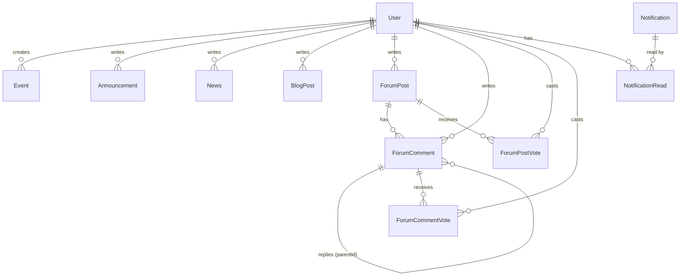

# Database Schema

Source of truth: [`api/prisma/schema.prisma`](../api/prisma/schema.prisma). Database: SQLite (`DATABASE_URL`, default `file:./dev.db`).

## Conventions

- **IDs:** every model has its own `id`, a UUID string generated by Prisma (`@default(uuid())`). News, announcements, blog posts, events, forum posts, and comments are all addressed by these IDs in the API (e.g. `GET /news/:id`). The database stores them as plain strings and does not enforce UUID format.
- **Timestamps:** `createdAt` is set on insert; `updatedAt` is maintained automatically (except on `Notification`, `NotificationRead`, which only have `createdAt` / `readAt`).
- **Tags:** SQLite has no array type, so `tags` is a JSON string (default `"[]"`) parsed in the service layer.
- **Uploads:** `coverImageUrl` / `avatarUrl` hold URLs returned by the upload endpoint, not binary data.

## Enums

| Enum | Values |
|------|--------|
| `Role` | `SUPERUSER`, `ADMIN`, `USER` |
| `UserStatus` | `ACTIVE`, `INACTIVE`, `PENDING`, `SUSPENDED`, `DELETED` |

## Entity relationships



`Notification` points at its source content loosely through `resourceType` + `resourceId` (no foreign key), so deleting the source does not cascade.

## Models

### User

| Field | Type | Notes |
|-------|------|-------|
| `id` | String | PK, UUID |
| `username` | String | Unique |
| `fullName` | String | |
| `email` | String | Unique |
| `passwordHash` | String | Never returned by the API |
| `role` | Role | Default `USER` |
| `status` | UserStatus | Default `PENDING` |
| `avatarUrl` | String? | |
| `createdAt`, `updatedAt` | DateTime | |

### Event

| Field | Type | Notes |
|-------|------|-------|
| `id` | String | PK, UUID |
| `title`, `description`, `location` | String | |
| `startAt`, `endAt` | DateTime | |
| `coverImageUrl` | String? | |
| `createdById` | String | FK → `User.id` |
| `createdAt`, `updatedAt` | DateTime | |

### Announcement

| Field | Type | Notes |
|-------|------|-------|
| `id` | String | PK, UUID |
| `title`, `description` | String | |
| `authorId` | String | FK → `User.id` |
| `createdAt`, `updatedAt` | DateTime | |

### News and BlogPost

Both models share the same shape.

| Field | Type | Notes |
|-------|------|-------|
| `id` | String | PK, UUID |
| `title` | String | |
| `content` | String | Markdown |
| `tags` | String | JSON array string, default `"[]"` |
| `coverImageUrl` | String? | |
| `authorId` | String | FK → `User.id` |
| `createdAt`, `updatedAt` | DateTime | |

### ForumPost

| Field | Type | Notes |
|-------|------|-------|
| `id` | String | PK, UUID |
| `title`, `content` | String | `content` is Markdown |
| `score` | Int | Denormalized sum of votes, default `0` |
| `authorId` | String | FK → `User.id` |
| `createdAt`, `updatedAt` | DateTime | |

### ForumComment

| Field | Type | Notes |
|-------|------|-------|
| `id` | String | PK, UUID |
| `content` | String | Markdown |
| `score` | Int | Denormalized sum of votes, default `0` |
| `postId` | String | FK → `ForumPost.id`, cascade delete |
| `authorId` | String | FK → `User.id` |
| `parentId` | String? | FK → `ForumComment.id` for replies, cascade delete |
| `createdAt`, `updatedAt` | DateTime | |

### ForumPostVote and ForumCommentVote

| Field | Type | Notes |
|-------|------|-------|
| `id` | String | PK, UUID |
| `value` | Int | `1` or `-1` |
| `userId` | String | FK → `User.id`, cascade delete |
| `postId` / `commentId` | String | FK → target, cascade delete |
| `createdAt`, `updatedAt` | DateTime | |

Unique on `(userId, postId)` or `(userId, commentId)`: one vote per user per target.

### Notification

| Field | Type | Notes |
|-------|------|-------|
| `id` | String | PK, UUID |
| `type`, `title`, `body` | String | |
| `resourceType`, `resourceId` | String | Points at the source record (no FK) |
| `createdAt` | DateTime | |

### NotificationRead

| Field | Type | Notes |
|-------|------|-------|
| `id` | String | PK, UUID |
| `userId` | String | FK → `User.id` |
| `notificationId` | String | FK → `Notification.id`, cascade delete |
| `readAt` | DateTime | |

Unique on `(userId, notificationId)`.

## Working with the schema

```bash
cd api
npx prisma migrate dev     # apply migrations / create a new one after editing schema.prisma
npx prisma studio          # browse data in a UI
```

For the HTTP view of these models, see the generated [`openapi/openapi.json`](../openapi/openapi.json) or Swagger at `/api`.
